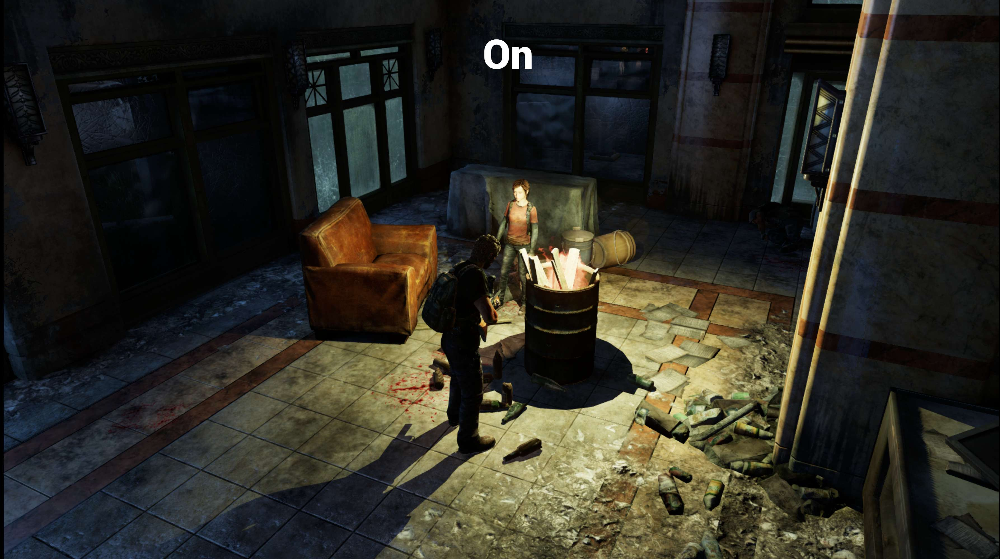
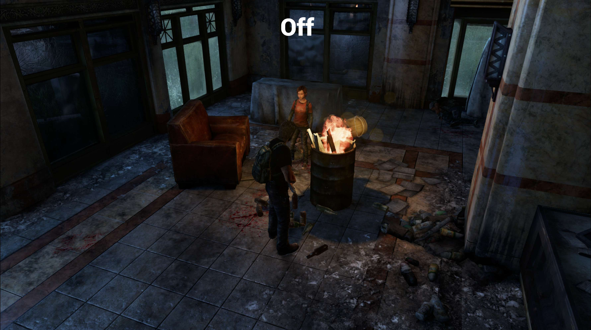
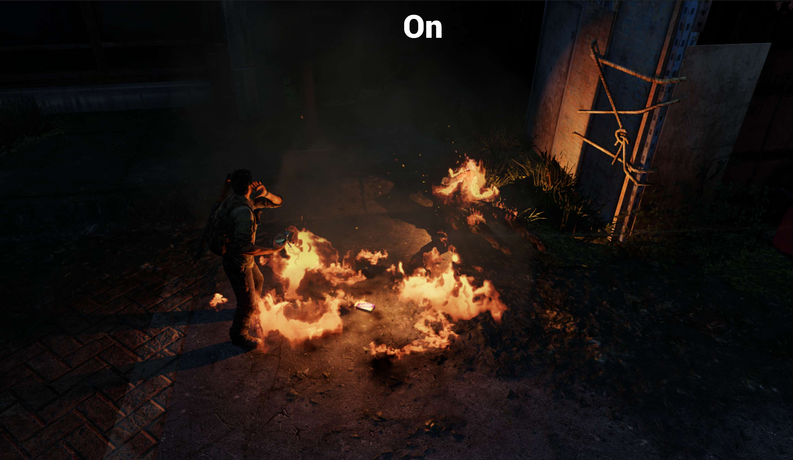
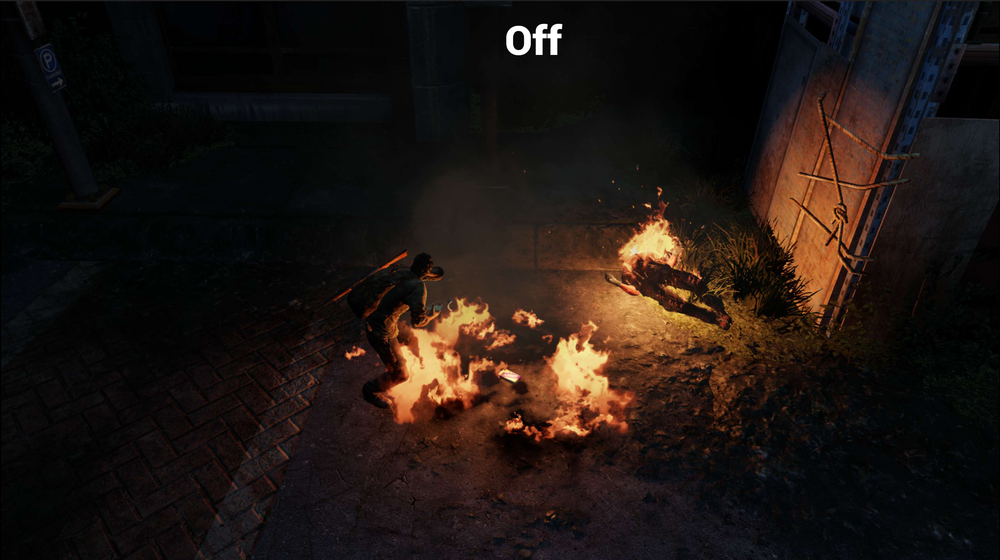
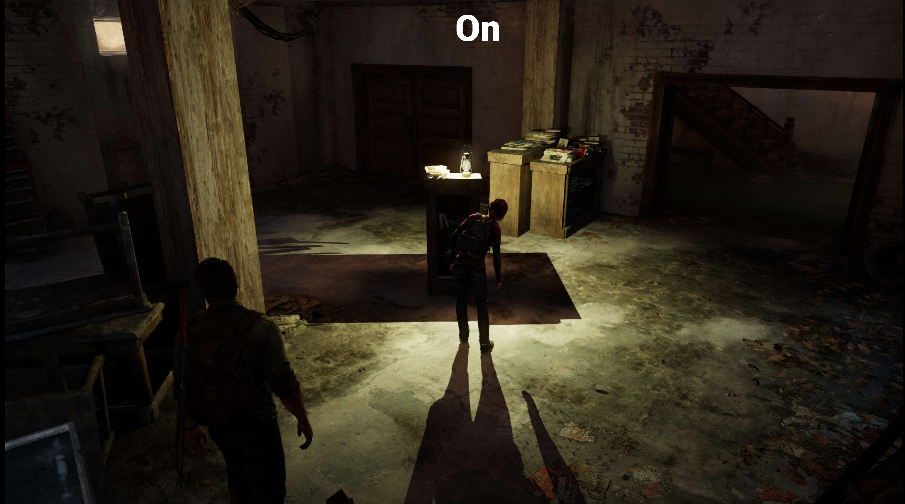
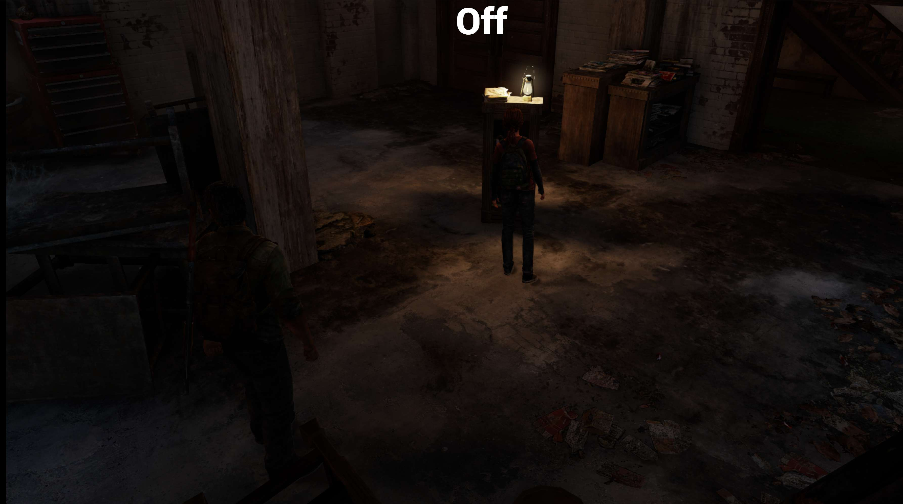
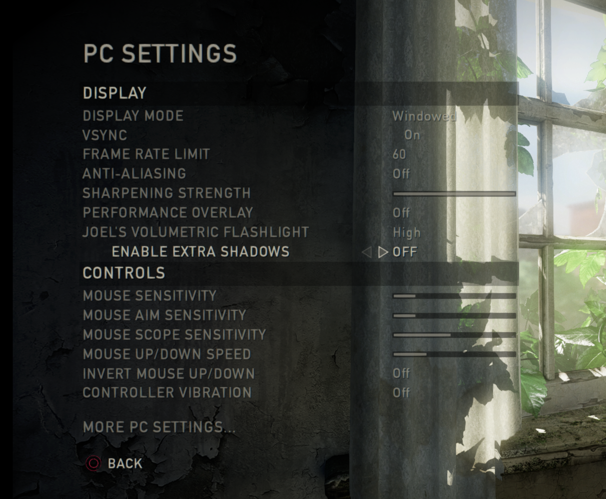

# Extra Shadows

Enable the option under **Options → PC Settings → Display → Enable Extra Shadows**. It defaults to **OFF**, which uses the game's original lighting for the affected emitters. **ON** lets those lights cast dynamic shadows on characters and surrounding geometry. It can be GPU-intensive, especially in scenes with several overlapping shadow-casting lights.

## Runtime integration

1. Append `GOW3_PC_FIRE_SHADOWS` to the PC settings enum before its count sentinel. Read and persist `fire_shadows=0|1` in the port's existing settings code. Add a localized toggle immediately below Performance Overlay, using the menu's native binary binding.
2. In `src/probe.c`, install the guest-call redirects for CUSA00552 01.11. Verify the mapped ranges and original instruction bytes before writing each redirect. Keep the trampolines near the image and use the guest ABI. Work on aligned copies of light descriptors. In OFF, the hooks preserve the original submission and culling decisions.
3. At `0xA635E4`, intercept point-light submission and call the original constructor at `0xA638B0`. Enable omni shadow maps with flag `0x200` after classifying an eligible emitter. For persistent Molotov fire, match type 3 in the lower 24 bits, radius greater than 1.5, and the original RGB ratios. Preserve the upper flag byte and the source light's position, color, range and intensity. Matching only the stable flag bits prevents the transient upper byte from switching the shadow on and off.
4. For burning barrels, identify the authored exterior point light by type, range and warm RGB ratios. Move its origin up by 0.45 units and use the shared lantern profile (RGB 7.50 / 7.2894 / 4.9725, radius 4.5, intensity 0.60). Reduce the matching short-range interior fill to 25%. At `0xA97020`, allow the expanded light bounds to be evaluated even when the original emitter's view mask rejects it. Deduplicate recognized sources by world position and submit nearby ones before the per-view culling bounds are copied at `0xA970C6`. Dynamic discovery applies across chapters and four known barrel positions also have static anchors.
5. At the same per-view stage, submit the catalogued stationary lantern placements with an upward offset of 0.22 units. This makes their shadows independent of Joel's flashlight. For the kerosene model in Tommy's Dam, identify authored type-1 point lights of radius 2 with RGB near either 1.30 / 0.8717 / 0.40 or 1.00 / 0.758 / 0.50. The second palette was captured in the room with Ellie and Maria and at the pump-room lantern. Promote those native emitters in place with the shared lantern profile and the 16–24 unit shadow fade. Keep static per-view placements for pump-room lantern 5 at XYZ `(-3.89210, 6.31069, -4.48367)` and turbine-hall lantern 8 at `(-74.06360, 4.62890, -27.98560)`. The pump-room lantern 4 now uses its authored emitter.
6. At `0xA63897`, recognize the original weapon workbench spotlight by its palette, 1.5-unit range and cone angles. Forward the authored light to `0xA63FF0` with spotlight shadow flag `0x100`, range 2.6 and 2.05× intensity. Its direction and cone stay authored. The matcher applies to workbench lamps using that profile throughout the game.
7. In the Vulkan renderer, track indirect draws' reads of argument and count buffers after synchronization. Include indirect command reads in the read mask. Use the resolved texture descriptor after rebind and retain accumulated reader stages on same-layout reads. Leave the volumetric shader logic, constants and cache selection as provided by the port.

## Build and validate

Integrate the source changes into the full port checkout and configure the Windows CMake/Ninja toolchain with the port dependencies. Run `ninja -C gow3_pc/out/gpu gow3-probe` from the root when that directory is your configured build. Use the result with a CUSA00552 01.11 installation and retain the installed volumetric shader cache.

Compare ON/OFF at a Molotov fire, a barrel, both lantern models and a weapon workbench. Include the tabletop kerosene lantern in the pump-room fight before reaching Ellie and Maria. With ON, pan until the barrel itself is outside the frame while its lit floor remains visible. Toggle Joel's flashlight at a stationary lantern and check the volumetric beams with the same cache and graphics settings. Compare GPU frame time in the same scene to measure the cost. Set `TLOU_TRACE_FIRE_SHADOW_SELECTION=1` for classifier diagnostics and `TLOU_TRACE_FIRE_SHADOW_ATLAS=1` for the atlas counter. Add `TLOU_TRACE_DYNAMIC_BARRELS_ONLY=1` to exercise discovery without the four catalogued barrel anchors.

## Windows reference package

Close the game and launcher, back up `gow3_pc/out/gow3-probe.exe`, then replace it with the executable from the companion ZIP. Keep the existing game files and shader cache. Relaunch and select **Enable Extra Shadows** in PC Settings. Restore the backup to uninstall. The package contains its checksum, Portuguese installation and integration instructions, and the reference screenshots. It comes from the visually tested Windows build shown below.

## Visual comparison

OFF shows the game's original lighting. The screenshots are from the Windows reference build, which also displays the separate Joel flashlight option.

| Scene | ON | OFF |
| --- | --- | --- |
| Burning barrel |  |  |
| Molotov fire |  |  |
| Bill's basement lantern |  |  |

