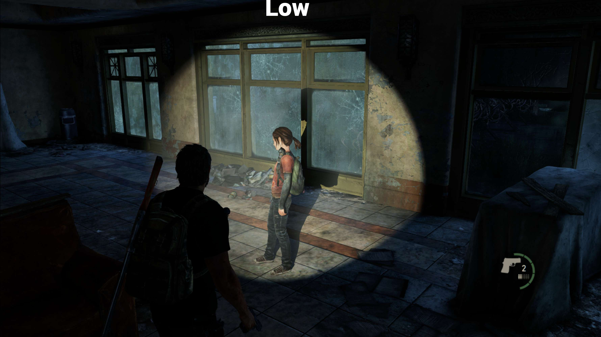
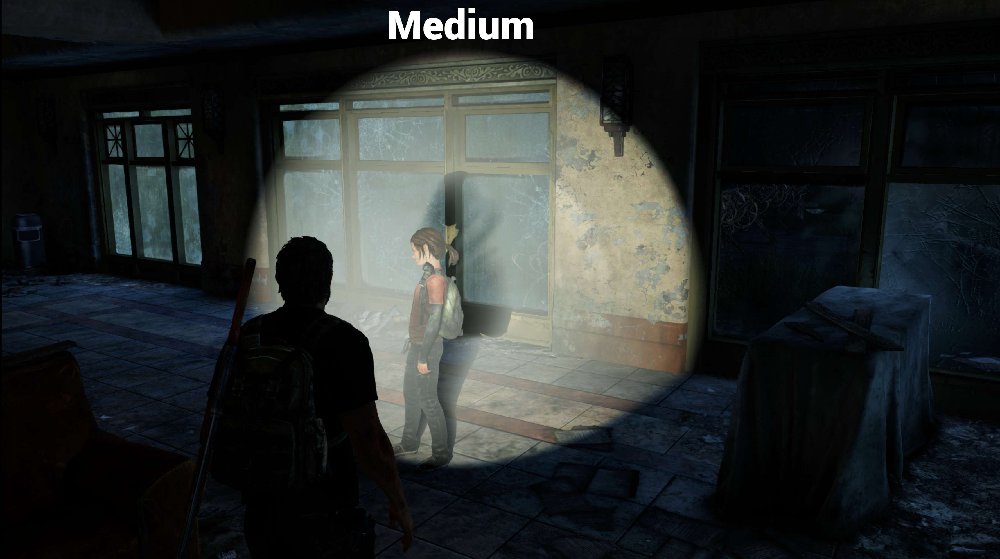
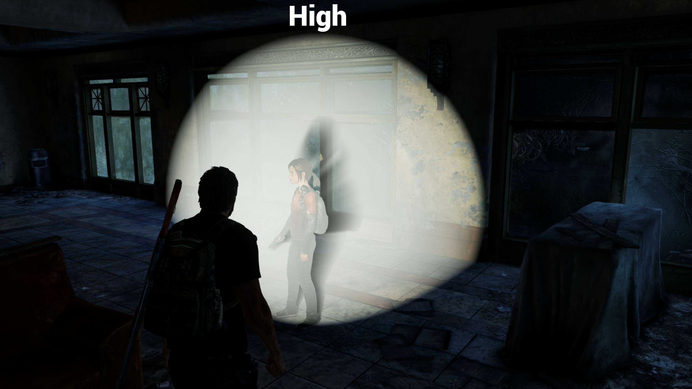
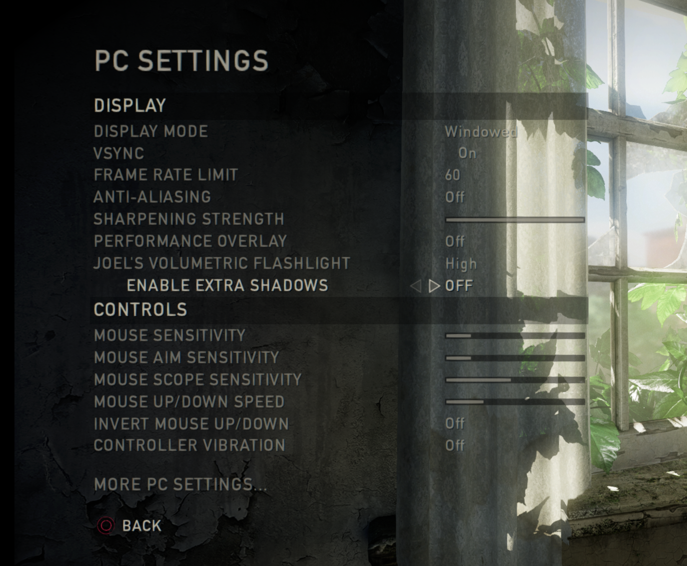

# Joel's volumetric flashlight

Open **Options → PC Settings → Joel's Volumetric Flashlight**, immediately below **Performance Overlay**. The option is localized with the rest of PC Settings and applies while the game is running.

| Setting | Effect | Volumetric density |
| --- | --- | --- |
| **Off** | Submit the original flashlight descriptor. The game uses its stock flashlight. | Original game behavior |
| **Low** | Subtle visible beam. | 0.0275 |
| **Medium** | More pronounced beam. | 0.0605 |
| **High** | Strongest beam. | 0.11 |

The three enabled modes use the same projector geometry and differ in the density passed to the port's existing volumetric lighting path. Apparent brightness also depends on the scene and camera angle.

| Low | Medium | High |
| --- | --- | --- |
|  |  |  |



The screenshots are from the contributor's Windows test installation. The additional **Enable Extra Shadows** row shown in the menu belongs to that installation.

## Implementation

1. Register `GOW3_PC_VOLUMETRIC_FLASHLIGHT` in `gow3_pc/gpu/gow3gpu.h`. In `gpu/shim/gow3_settings.h` and `gpu/shim/gow3_settings.cpp`, add the atomic setting, four-value getter and setter, and the `volumetric_flashlight_level` INI key. An unset value reads as Off. If a configuration from the earlier prototype has `volumetric_flashlight=1` and no explicit level, migrate it to High. The setting follows the existing PC menu save path.
2. Add a native list row after `GOW3_PC_PERF_OVERLAY` in `gow3_pc/src/runtime_menu_pc.c`. Add the row title and the four value labels to each existing language-table entry. Use the existing native list binding for cycling the values and reading back the selection.
3. In `gow3_pc/src/probe.c`, validate the guest call at image offset `0x32242` for CUSA00552 01.11 and redirect it to the wrapper around the original spotlight submission at `0xA63FF0`. Read the live setting and the primary projector flag `0x00400000`. For Off and other submitted lights, call the original function with the same descriptor. For the enabled player flashlight, copy the descriptor and adjust the copy.
4. Use the guest's camera pullback at `0x181AE94` to move the copied emitter forward to the flashlight lens. Keep the full volumetric extent and compensate the projector angle for a reference wall roughly three metres away. At other distances the apparent boundary can differ from the original light, whose virtual origin is behind the lens.
5. Write the volumetric range fraction, angle fraction and chosen density at descriptor offsets `0xA0`, `0xA4` and `0xA8`. Tag the copied descriptor to identify it inside the spotlight builder. A second byte-checked hook at `0xA64997` loads the chosen density directly for this tagged projector, while other lights continue through the native view gate and fade.
6. Keep the normal cone dimensions across scripted transitions. For the specific reduced projector profile observed after the window in Tommy's Dam, compensate the measured 30% power and 5% RGB scales. Clamp those values to their normal reference so the adjustment preserves the flashlight's ramps and avoids boosting the reduced profile beyond normal output.

## Apply and build

From a clean checkout of the port at the PR base, apply the supplied source patch or check out the PR branch. Initialize the pinned submodules and follow the port's Windows build guide. The commands below assume an MSYS2 CLANG64 shell with the documented dependencies installed.

```sh
git apply --check joel-volumetric-flashlight.patch
git apply joel-volumetric-flashlight.patch
git submodule update --init --recursive
bash gow3_pc/build.sh
```

Use the game's **PC Settings** menu to check all four values. With the same camera and player position, compare Off with the base build, then move from Low to High and check the beam contribution. Restart the game and confirm that the setting persists. In Tommy's Dam, compare the enabled beam before and after the window and after a checkpoint restart. The hook offsets were identified on CUSA00552 01.11. Validate the byte signatures and descriptor layout independently before using them on another guest revision.
